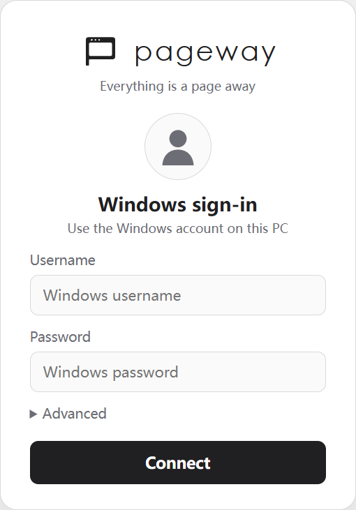
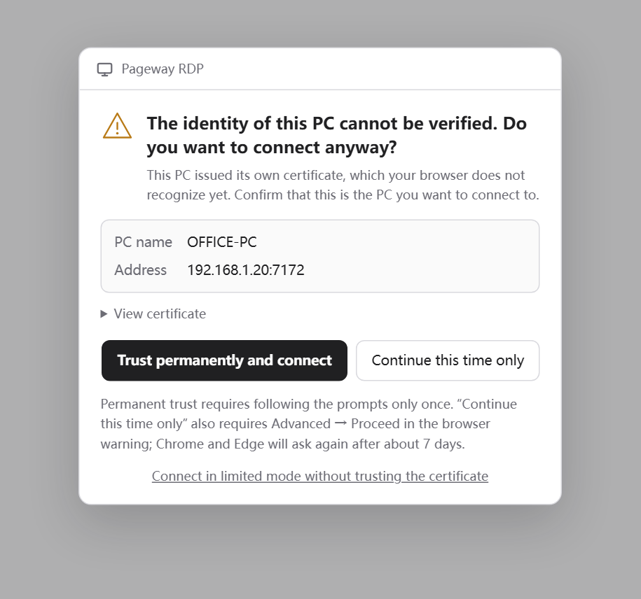

# Pageway

**English** | [简体中文](README.zh-CN.md)

Self-hosted remote desktop for a Windows PC, delivered through its own web page. The gateway runs on the controlled PC; no central service, account system, or separate remote client is required.

**Everything is a page away.**

[](https://github.com/pageway/pageway-rdp/releases)
[](https://github.com/pageway/pageway-rdp/actions/workflows/release.yml)
[](LICENSE)



## Features

- Runs directly on the controlled Windows PC and connects only to its local RDP service.
- Uses IronRDP in the browser for CredSSP/NLA, desktop decoding, and rendering.
- Supports dynamic resolution, HiDPI physical-pixel rendering, actual-size/fit/fill scaling, and 32-bit lossless or 16-bit compressed graphics.
- Provides fullscreen mode, Ctrl+Alt+Del, Windows key, a pinnable auto-hiding connection bar, and clipboard integration.
- Includes Simplified Chinese and English interfaces, plus light, dark, and system themes.
- Ships x64 and ARM64 installers for machine-wide or current-user installation.

## Requirements

Pageway supports Windows 10/11 Pro, Enterprise, and Education, and Windows Server 2016 or later. Windows Home does not include an RDP server and cannot be the controlled PC.

The installer checks for the native Windows RDP host components; it does not install or replace Windows components. The controlled PC needs no Rust, Node.js, Python, or additional runtime.

Use a current Chromium-based browser or Firefox on the connecting device.

## Install

Download the appropriate installer from [Releases](https://github.com/pageway/pageway-rdp/releases/latest):

| Scope | Architecture | File |
| --- | --- | --- |
| All users, administrator required | x64 (AMD64) | `Pageway-Setup-1.0.0-windows-x64.exe` |
| Current user | x64 (AMD64) | `Pageway-Setup-1.0.0-windows-x64-user.exe` |
| All users, administrator required | ARM64 | `Pageway-Setup-1.0.0-windows-arm64.exe` |
| Current user | ARM64 | `Pageway-Setup-1.0.0-windows-arm64-user.exe` |

The bilingual installer defaults to port `7172`. It enables Remote Desktop, adds a firewall exception for Pageway, and starts Pageway after Windows sign-in. A current-user installation can request administrator approval once for these system changes.

Open **Pageway** from the Start menu, or visit:

```text
http://127.0.0.1:7172/
```

## Connect

Sign in with the Windows username and password of the controlled PC. From another device, replace `127.0.0.1` with the PC's LAN or private-overlay-network address.

Pageway remembers the last username and display preferences. It does not store the Windows password; password storage is left to the browser's password manager.

### First connection and certificate trust

When another device first connects over HTTP, Pageway asks how to trust the PC's local certificate.



- **Trust permanently and connect**: download the platform-specific trust file and follow the on-screen steps. On Windows, the same local root certificate works with Chrome, Edge, and Firefox 120 or later.
- **Continue this time only**: continue through the browser's certificate warning with **Advanced → Proceed**. Chrome and Edge normally ask again after about seven days.
- **Limited mode**: stay on HTTP without trusting the certificate. Clipboard transfer uses the manual text panel, and fullscreen system-key capture is unavailable.

Both trust options use HTTPS and WSS for the remote session. The local CA is restricted to the PC name and private-network addresses. Pageway replaces the website certificate when local IP addresses change, without requiring the root certificate to be imported again.

> **Security:** do not expose the Pageway port directly to the public internet. Use a trusted LAN or a private overlay network.

### During a session

The connection bar provides fullscreen, Ctrl+Alt+Del, Windows key, clipboard, and disconnect controls. It is pinned by default. Unpin it to hide automatically after three seconds; move the pointer to the top edge to reveal it again. On HTTPS, Chromium can capture Windows shortcuts in fullscreen mode.

The default display mode uses actual size, 32-bit lossless graphics, dynamic resolution, and physical pixels matching the local display scale. Open **Advanced** before connecting to choose fit/fill scaling or 16-bit compressed graphics.

On localhost or HTTPS, Chromium can synchronize text, HTML, and PNG clipboard content automatically. Firefox and HTTP sessions use the clipboard panel for manual text transfer.

Audio, printing, file transfer, microphone, and camera are not available yet; see the [Roadmap](#roadmap).

## Settings and uninstall

Run the installer again to change the web port. The RDP destination is fixed to `127.0.0.1:3389`; Pageway is not an intermediate RDP proxy.

Configuration, logs, and local certificates are stored in `%LOCALAPPDATA%\Pageway`:

```text
config.json
gateway.log
tls\
```

Uninstall Pageway from Windows **Installed apps**. The uninstaller can ask whether to keep configuration and logs. Silent uninstall removes them:

```powershell
& "$env:ProgramFiles\Pageway\uninstall.exe" /S
```

For a current-user installation, the uninstaller is under `$env:LOCALAPPDATA\Programs\Pageway\uninstall.exe`. Uninstalling does not disable Windows Remote Desktop, because it may have been enabled before installation or used by other software.

## Roadmap

Pageway aims to offer what the native Windows Remote Desktop client (mstsc) offers wherever a browser allows it, and to handle each feature the way mstsc does. The work is split into four phases; each phase is tested on real Windows hosts and released as its own minor version. The product boundary is the same in every phase: Pageway connects only to the PC's own RDP service at `127.0.0.1:3389`, has no central server, and installs no Windows components.

Items marked **HTTPS** need a secure page (a trusted certificate or localhost). Browsers disable the APIs they rely on in limited mode.

### Phase 1 — Foundation (done in 1.0.0)

- IronRDP maintained as a forked submodule instead of build-time patches.
- HTTPS/WSS on the same port as HTTP, the first-trust prompt, and certificate downloads for each platform.
- HiDPI sharpness: the session uses physical pixels and a scale factor that follow the local display scale.
- Fullscreen, an mstsc-style connection bar, and Windows shortcut capture in fullscreen.
- Text, HTML, and image clipboard on HTTPS, with the manual text panel as the HTTP fallback.

### Phase 2 — Local resources

Corresponds to the **Local Resources** tab in mstsc.

- **Remote audio**, with the same three options as mstsc:
  - *Play on this computer* (default): play remote sound in the browser, starting with PCM and then adding IMA-ADPCM to save bandwidth. Works on HTTP as well.
  - *Play on remote computer*: leave sound on the remote PC.
  - *Do not play*: the current behavior.
- **Printing**: enabled by default, as in mstsc. A virtual printer based on the `Microsoft Print to PDF` driver appears in the remote session; each print job opens as a PDF in a new browser tab, from which it can be printed locally.
- **File transfer**: drag files onto the remote screen to paste them on the remote PC; files copied on the remote PC are offered as browser downloads. Mapping a local folder as a remote drive is in Phase 4.
- **Audio recording** (HTTPS): send the local microphone to the remote PC. Off by default, as in mstsc.
- **Release check**: a remote system sound plays locally; printing from Notepad produces a PDF in the browser; drag-and-drop upload and remote-copy download work; the microphone records in the remote session.

### Phase 3 — Smoothness

Corresponds to the **Experience** tab in mstsc and to the graphics channel mstsc uses by default.

- **Bulk compression**: enable RDP 6.1 bulk compression to reduce bandwidth at almost no cost.
- **Connection speed presets**: LAN, broadband, and low-speed presets, as in mstsc, controlling desktop background, font smoothing, desktop composition, window contents while dragging, menu and window animation, and visual styles. LAN (everything on) is the default.
- **Time zone redirection**: send the browser's time zone so the remote session shows local time.
- **Automatic reconnection**: keep the server's auto-reconnect cookie, reconnect automatically after a network drop, and show an mstsc-style "Reconnecting" overlay.
- **Graphics pipeline (RDPGFX)**: the change with the largest effect on smoothness and bandwidth. Start with codecs that need no external decoder (Planar, ClearCodec, RemoteFX Progressive), then add H.264 AVC420/AVC444 decoding through WebCodecs (HTTPS). The color-depth option then follows mstsc's "Highest quality (32-bit)" meaning.
- **Release check**: the graphics channel is negotiated with the server; cutting the network reconnects the session automatically.

### Phase 4 — Experimental

These depend on newer or browser-specific APIs.

- **Multiple monitors** (HTTPS, Chromium): use the Window Management API to span the session across local monitors.
- **Touch input**: send touch gestures to the remote PC as RDP multi-touch input.
- **Camera** (HTTPS): redirect the local camera to the remote PC, encoding video with WebCodecs.
- **Mobile soft keyboard**: type into the remote session with the on-screen keyboard of a phone or tablet.
- **Local folder as a remote drive** (Chromium): map a folder chosen in the browser as a drive in the remote session.

### Not planned

- Smart cards, serial and parallel ports, USB, and other Plug and Play devices: browsers do not provide the device access these require. WebUSB covers only a few devices and remains a research item.
- RD Gateway, server redirection, and UDP transport: outside Pageway's product boundary, or unavailable in browsers.

## Architecture

```text
Browser (IronRDP WASM) ── WebSocket / RDCleanPath ──> Pageway gateway ── TLS ──> Local RDP service (3389)
```

The browser performs CredSSP/NLA, desktop decoding, and rendering. The Rust gateway handles protocol ingress, TLS termination, and bidirectional byte relay.

## Development

Build instructions, repository layout, checks, and the release process are in [CONTRIBUTING.md](CONTRIBUTING.md). User-facing changes are recorded in [CHANGELOG.md](CHANGELOG.md).

## License

Pageway is available under the [MIT License](LICENSE).

Thanks to [Devolutions IronRDP](https://github.com/Devolutions/IronRDP) for the RDP protocol stack and web client. Pageway's IronRDP changes are maintained in the fork referenced by the `IronRDP` submodule.
