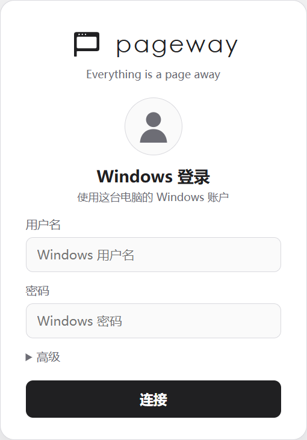
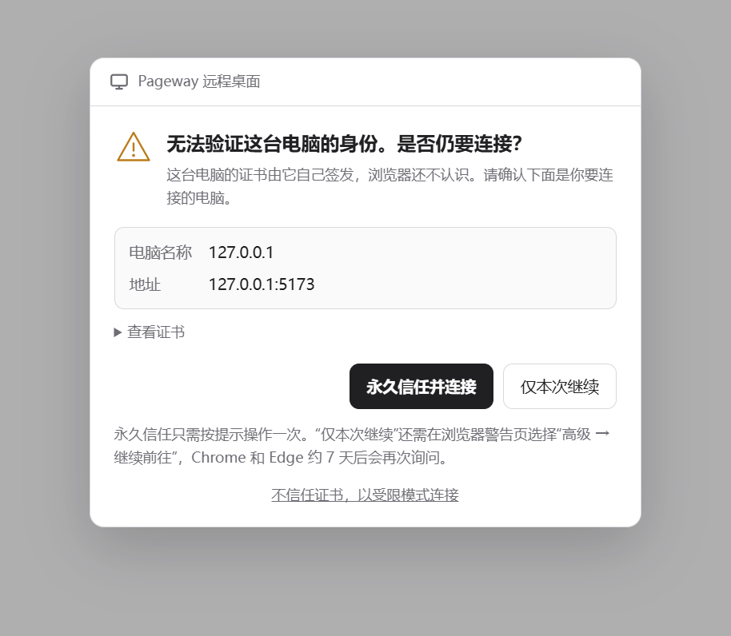

# Pageway

[English](README.md) | **简体中文**

把这台 Windows 电脑的远程桌面装进浏览器。网关运行在被控机上，不需要中心服务、账号系统，也不需要在其他设备上安装远程客户端。

**Everything is a page away.**

[](https://github.com/pageway/pageway-rdp/releases)
[](https://github.com/pageway/pageway-rdp/actions/workflows/release.yml)
[](LICENSE)



## 功能

- 直接运行在被控 Windows 电脑上，只连接这台电脑自己的 RDP 服务。
- 浏览器通过 IronRDP 完成 CredSSP/NLA、桌面解码和渲染。
- 支持动态分辨率、高分屏物理像素渲染、原始大小/适应窗口/填满窗口，以及 32 位无损或 16 位压缩图形。
- 提供全屏、Ctrl+Alt+Del、Windows 键、可钉住并自动隐藏的连接栏和剪贴板。
- 支持简体中文/英文，以及浅色、深色和跟随系统主题。
- 提供 x64、ARM64，以及所有用户/当前用户四种安装包。

## 环境要求

Pageway 支持 Windows 10/11 专业版、企业版、教育版，以及 Windows Server 2016 或更高版本。Windows 家庭版不提供远程桌面服务端，无法作为被控机。

安装器会检查原生 RDP 宿主组件，但不会安装或替换 Windows 组件。被控机运行时不需要 Rust、Node.js、Python 或额外运行库。

连接设备请使用较新的 Chromium 浏览器或 Firefox。

## 安装

从 [Releases](https://github.com/pageway/pageway-rdp/releases/latest) 下载适合这台电脑的安装包：

| 安装范围 | 处理器架构 | 文件 |
| --- | --- | --- |
| 所有用户，需要管理员 | x64（AMD64） | `Pageway-Setup-1.0.0-windows-x64.exe` |
| 当前用户 | x64（AMD64） | `Pageway-Setup-1.0.0-windows-x64-user.exe` |
| 所有用户，需要管理员 | ARM64 | `Pageway-Setup-1.0.0-windows-arm64.exe` |
| 当前用户 | ARM64 | `Pageway-Setup-1.0.0-windows-arm64-user.exe` |

双语安装器默认使用端口 `7172`。安装器会启用本机远程桌面、允许 Pageway 通过防火墙，并设置登录 Windows 后自动启动。当前用户安装可能因这些必要配置请求一次管理员授权。

从开始菜单打开 **Pageway**，或直接访问：

```text
http://127.0.0.1:7172/
```

## 连接

输入被控电脑的 Windows 用户名和密码。其他设备把 `127.0.0.1` 换成这台电脑的局域网或私网组网地址。

Pageway 会记住上次输入的用户名和显示偏好，自身不保存 Windows 密码；密码由浏览器密码管理器按需保存。

### 首次连接与证书信任

第一次从其他设备通过 HTTP 访问时，Pageway 会要求选择如何信任被控电脑的本机证书。



- **永久信任并连接**：下载对应平台的信任文件并按页面步骤操作。Windows 上同一个本机根证书可供 Chrome、Edge 和 Firefox 120 及以上版本使用。
- **仅本次继续**：在浏览器安全警告页选择“高级 → 继续前往”。Chrome 和 Edge 通常约 7 天后会再次询问。
- **受限模式**：不信任证书并继续使用 HTTP。剪贴板通过手动文本面板收发，全屏系统组合键捕获不可用。

两种信任方式的远程会话都使用 HTTPS 和 WSS。本机根证书仅允许本机名和私网地址。本机 IP 变化时网关会自动换发网站证书，无需重新导入根证书。

> **安全提示：**不要把 Pageway 端口直接暴露到公网。请只在可信局域网或私网组网中使用。

### 会话操作

顶部连接栏提供全屏、Ctrl+Alt+Del、Windows 键、剪贴板和断开连接。默认钉住；取消钉住后 3 秒自动隐藏，鼠标移到屏幕顶边可重新打开。HTTPS 页面中，Chromium 全屏时可以捕获 Windows 组合键。

默认使用原始大小、32 位无损图形和动态分辨率，并按本机屏幕缩放比例使用物理像素。连接前可在“高级”中改为适应窗口、填满窗口或 16 位压缩图形。

在 localhost 或 HTTPS 页面中，Chromium 可自动同步文本、HTML 和 PNG 图片。Firefox 和 HTTP 会话通过剪贴板面板手动收发文本。

当前版本不支持声音、麦克风、摄像头或视频重定向。

## 设置与卸载

需要修改网页端口时，重新运行安装器。RDP 目标固定为 `127.0.0.1:3389`，Pageway 不提供中间 RDP 代理模式。

配置、日志和本机证书位于 `%LOCALAPPDATA%\Pageway`：

```text
config.json
gateway.log
tls\
```

在 Windows“安装的应用”中卸载 Pageway。卸载时可选择是否保留配置和日志，静默卸载会同时删除它们：

```powershell
& "$env:ProgramFiles\Pageway\uninstall.exe" /S
```

当前用户安装的卸载程序位于 `$env:LOCALAPPDATA\Programs\Pageway\uninstall.exe`。卸载不会关闭 Windows 远程桌面，因为它可能在安装前已经启用或被其他用途使用。

## 后续路线

以下三个阶段均为待推进项，不是当前版本已经具备的能力。每个阶段都必须保持现有产品边界：每台被控机运行自己的网关，不做中心账号或管理服务，不强制经过中转，不默认暴露公网，也不静默保存凭据。

### 第二阶段：补齐日常 RDP 体验

**目标：**在增加其他协议之前，先让现有 Windows RDP 客户端适合长时间日常使用。

- **音频：**先实现远程声音输出以及静音、音量控制。麦克风输入单独评估；摄像头和视频重定向在没有真实端到端支持前，不在界面上伪装成可用功能。
- **文件与磁盘：**基于 IronRDP 已有的文件传输能力，先做方向明确的主动上传、下载，再评估驱动器重定向。必须由用户明确操作并看清本地/远程方向，不默认暴露整块本地磁盘。
- **输入覆盖：**验证 Unicode、输入法、国际键盘布局、失焦后的按键释放，以及 Chromium 和 Firefox 下的特殊组合键。
- **显示覆盖：**验证多显示器、显示器变更、DPI 变化、窗口调整和全屏切换，不能破坏现有动态分辨率和无溢出布局。
- **验收门槛：**重新覆盖 Windows 10/11、Windows Server、弱网、长时间会话、剪贴板回归、断开重连和资源清理。没有完整实现和实测的功能不进入正式界面。

### 第三阶段：在不改变产品模式的前提下增加 VNC

**目标：**通过同样的本机网页入口连接被控机已有的 VNC 服务，同时保持 RDP 路径独立。

- 选择持续维护的 RFB/VNC 实现前，核对许可证、协议覆盖范围，以及 WebAssembly 或网关接入成本；协议实现与共享界面保持分离。
- 首先支持桌面画面、键鼠输入、缩放和文本剪贴板。服务端调整分辨率、音频和文件传输分别评估，不能假设它们与 RDP 行为一致。
- 按 VNC 服务端实际能力设计认证和传输安全。不能把传统 VNC 密码认证描述成加密传输，不能静默接受未知 TLS 身份，也不能不加调整地照搬 RDP 证书页面。
- 明确支持的网关操作系统和安装包。增加 Linux VNC 宿主时，不能削弱或复杂化现有 Windows RDP 安装流程。
- 至少用两个持续维护的 VNC 服务端实测，覆盖密码错误、断线、尺寸变化、键盘布局和不可信网络；服务端特有的限制要写在对应连接选项旁。

### 第四阶段：增加 SSH 网页终端

**目标：**连接被控机自己的 SSH 服务，提供浏览器终端，并继续保持无中心服务的产品边界。

- 使用持续维护的 SSH 实现前先审查许可证和安全性。先支持密码和 keyboard-interactive 认证；如果增加私钥和密码短语，只能保存在内存中，不得写入 Pageway 配置或日志。
- 认证前完成主机密钥验证，提供清晰的指纹确认流程；已信任主机密钥发生变化时必须直接失败，不能默认接受所有主机密钥。
- 支持 UTF-8、终端尺寸调整、颜色、回滚、剪贴板和可靠的控制键，终端会话状态与 RDP/VNC 组件隔离。
- 端口转发、代理转发、SFTP 和隧道功能延后，基础终端稳定前不实现，也不能隐式开启。
- 覆盖 Windows OpenSSH Server 和至少一个持续维护的 Linux SSH 服务端，验证主机密钥不匹配、认证失败、断线、尺寸变化、非 ASCII 文本以及日志不泄露秘密。

## 架构

```text
浏览器（IronRDP WASM）──WebSocket / RDCleanPath──> Pageway 网关 ──TLS──> 本机 RDP 服务（3389）
```

浏览器完成 CredSSP/NLA、桌面解码和渲染。Rust 网关负责协议接入、TLS 终结和双向字节透传。

## 开发与发布

构建命令、目录结构、检查项和发布流程见 [CONTRIBUTING.md](CONTRIBUTING.md)。面向用户的变更记录在 [CHANGELOG.md](CHANGELOG.md)。

## 许可

Pageway 使用 [MIT 许可证](LICENSE)。

感谢 [Devolutions IronRDP](https://github.com/Devolutions/IronRDP) 提供 RDP 协议栈和 Web 客户端。Pageway 对 IronRDP 的修改维护在 `IronRDP` 子模块所引用的 fork 中。
